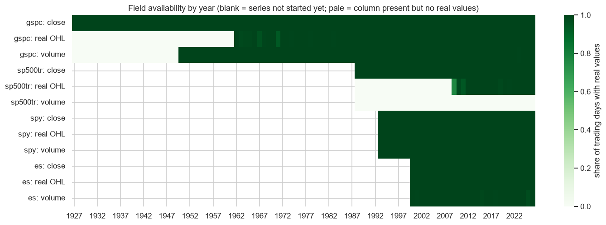
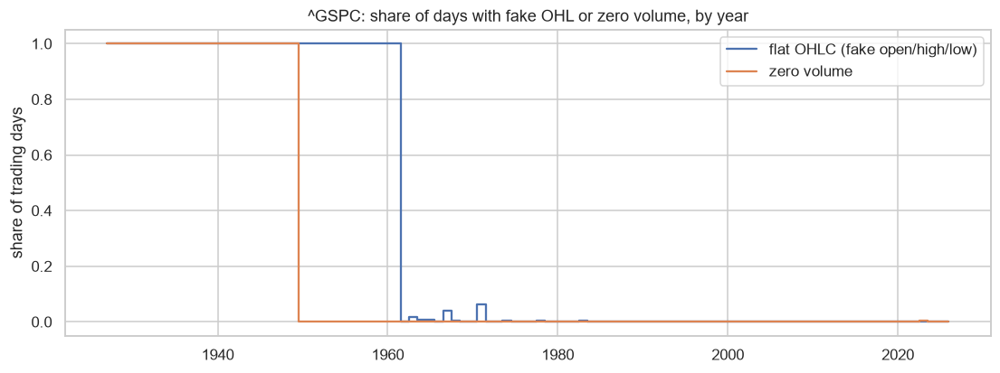
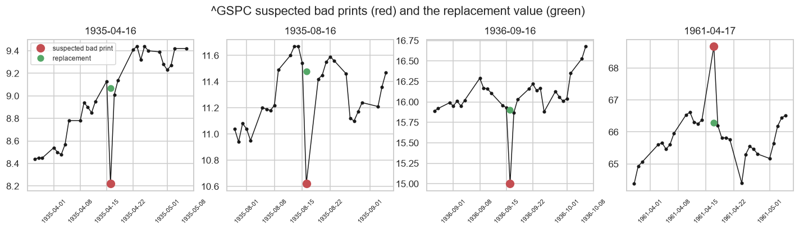
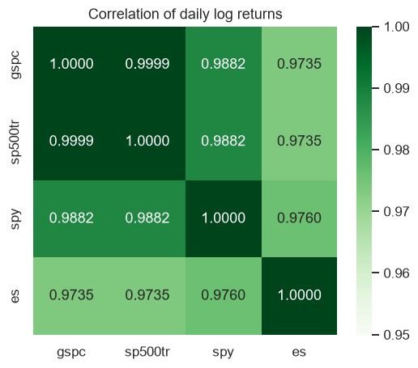
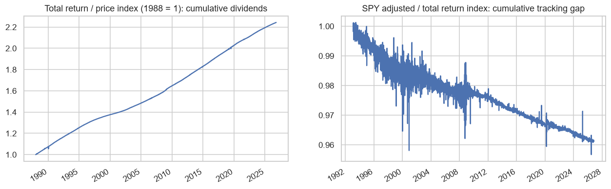

# 2. Data Understanding

This phase describes **where the data comes from** (sources) and **how good it is** (quality), using the raw snapshot in `data/raw/`. It was carried out after the cleaning code was written, so it also checks what cleaning changes, and it led to two fixes in the cleaning step.

- **Full analysis, with code and outputs:** [`notebooks/00_data_understanding.ipynb`](../notebooks/00_data_understanding.ipynb). It is already run, so the results show on GitHub.
- **Figures:** [`docs/figures/`](figures/)

## 2.1 Sources

All four series were downloaded from **Yahoo Finance** on 2026-10-25 and run through 2026-10-23.

| File | Ticker | What it is | Owner / original source | Range | Rows |
|---|---|---|---|---|---|
| `gspc.csv` | `^GSPC` | S&P 500 price index (dividends not included) | S&P Dow Jones Indices | 1927-12-30 → 2026-10-23 | 24,821 |
| `sp500tr.csv` | `^SP500TR` | S&P 500 total return index (dividends reinvested) | S&P Dow Jones Indices | 1988-01-04 → 2026-10-23 | 9,776 |
| `spy.csv` | `SPY` | SPDR S&P 500 ETF Trust; `adj_close` adjusted for dividends | State Street (NYSE Arca) | 1993-01-29 → 2026-10-23 | 8,492 |
| `es.csv` | `ES=F` | E-mini S&P 500 futures, continuous front month | CME Group (Globex) | 2000-09-18 → 2026-10-23 | 6,590 |

Every file has the columns `date, open, high, low, close, adj_close, volume`. Not every column contains real data, though:

| Field | Really available from |
|---|---|
| `^GSPC` close | 1927 |
| `^GSPC` open/high/low | **1962** (before that, O = H = L = C) |
| `^GSPC` volume | **1950** (zero before) |
| `^SP500TR` close | 1988 |
| `^SP500TR` open/high/low | 2010 (unreliable before); volume never |
| SPY close/OHL/volume | 1993 |
| ES close/OHL/volume | 2000 |

### Links

| Data | Yahoo Finance | Stooq | Official |
|---|---|---|---|
| `^GSPC` | [history](https://finance.yahoo.com/quote/%5EGSPC/history) | [^spx](https://stooq.com/q/d/?s=%5Espx) | [S&P DJI](https://www.spglobal.com/spdji/en/indices/equity/sp-500/) · [FRED SP500](https://fred.stlouisfed.org/series/SP500) (last 10 years only) |
| `^SP500TR` | [history](https://finance.yahoo.com/quote/%5ESP500TR/history) | – | S&P DJI (total-return version) |
| `SPY` | [history](https://finance.yahoo.com/quote/SPY/history) | [spy.us](https://stooq.com/q/d/?s=spy.us) | [State Street SPY](https://www.ssga.com/us/en/intermediary/etfs/spdr-sp-500-etf-trust-spy) |
| `ES=F` | [history](https://finance.yahoo.com/quote/ES%3DF/history) | [es.f](https://stooq.com/q/d/?s=es.f) | [CME E-mini S&P 500](https://www.cmegroup.com/markets/equities/sp/e-mini-sandp500.html) |

**Access and licensing:** Yahoo's API needs no sign-in, but Yahoo's terms don't allow redistribution, and S&P index values are licensed by S&P Dow Jones Indices (which is why FRED keeps only 10 years). The snapshot is included for non-commercial academic use. Stooq now blocks scripted downloads with a browser check, so the Stooq fallback in `data_download.py` may fail.

To refresh the data: `python -m sp500.data_download`

### Extra sources

**Added:** `^VIX` (CBOE Volatility Index), 1990-01-02 → 2026-10-23, in `data/raw/vix.csv`. It was tested as a feature group; see [06_modeling.md](06_modeling.md).

**Candidates (to add later, one group at a time):**

- **Volatility term structure:** VIX3M (`^VIX3M`), VIX9D, VVIX → VIX/VIX3M. Only from ~2007, which is short.
- **Sector ETFs:** XLK, XLF, XLE, XLV, XLY, XLP, XLI, XLU, XLB → dispersion and defensive vs. cyclical rotation.
- **Breadth:** share of constituents above their 200-day MA, advance/decline line.
- **Macro / rates:** 10Y–2Y spread, credit spreads (FRED).
- **News sentiment:** for the SVM + sentiment extension.

## 2.2 Quality

### Completeness and calendar

| Series | Duplicate dates | Missing closes | NYSE days missing | Extra non-NYSE days |
|---|---|---|---|---|
| `^GSPC` | 0 | 0 | – (it *is* the calendar) | 0 |
| `^SP500TR` | 0 | 0 | 0 | 0 |
| SPY | 0 | 0 | 0 | 0 |
| ES | 0 | 0 | 2 (2016-10-10, 2016-11-11) | 28 (futures trade on many US holidays) |

- **No Saturday rows,** although the NYSE traded on Saturdays until 1952. Yahoo leaves them out.
- **All long breaks are real closures:** the 1933 bank holiday (12 days), 9/11 (2001), Hurricane Sandy (2012), and the national day of mourning for President Ford (2007). The first day after the 1933 closure (+16.6%) covers 12 days of news.

### Validity

| Check | `^GSPC` | `^SP500TR` | SPY | ES |
|---|---|---|---|---|
| Zero or negative prices | 0 | 0 | 0 | 0 |
| high < low | 0 | 0 | 0 | 0 |
| Fake OHL rows (O = H = L = C) | 8,547 (8,509 before 1962) | 5,379 | 0 | 0 |
| Close outside high–low range | 0 | 0 | 0 | 10 (8 on quarterly expiry Fridays) |
| Zero-volume rows | 5,497 (all but 1 before 1950) | all | 0 | 11 |

### Outliers and suspected bad prints

Daily returns have **very fat tails**: excess kurtosis ≈ 19, and 110 moves beyond 5 standard deviations, where a normal distribution would expect 0.01. Almost every extreme day matches a documented event (1929 crash, 1933 reopening, Black Monday 1987 at −20.5%, 2008, COVID 2020). These are real and are **kept**.

There are **4 exceptions**: one-day spikes in calm markets that fully reverse the next day, with no matching event:

| Date | Move | Next day | Size vs. prior 3-month volatility |
|---|---|---|---|
| 1935-04-16 | −10.0% | +9.6% | 8.2 sd |
| 1961-04-17 | +3.5% | −3.6% | 7.1 sd |
| 1936-09-16 | −5.8% | +5.8% | 6.4 sd |
| 1935-08-16 | −8.0% | +7.5% | 5.5 sd |

**Rule** (`data_prep.find_bad_prints`): a > 3% move reversed the next day, where both days are ≥ 5 / ≥ 4.5 standard deviations of the previous 63 days' volatility, **and** no other source confirms it. The real −10% day on 2020-03-12 scores 5.2 sd but is confirmed by SPY, ES and the total-return index, so it's left alone. Before 1988 `^GSPC` has no second source, so these are *suspected* errors, not proven ones.

### Cross-source consistency

| Check | Result | Expected | Verdict |
|---|---|---|---|
| Daily return correlation between sources (2000–2026) | 0.97–1.00 | Very high | ✅ |
| Total return − price index growth (1988–2026) | **+2.30%/yr** (11.44% vs 9.14%) | ≈ S&P 500 dividend yield | ✅ |
| SPY adjusted − total return index | **−0.12%/yr** | ≈ SPY expense ratio (0.0945%) + cash drag | ✅ |
| ES − index gap in roll windows vs. other days | 0.12% vs. 0.14% | Bigger in roll windows if jumps exist | Roll jumps not visible |

The biggest ES-vs-index daily gaps (March 2020, March 2009) come from **closing-time differences**: ES settles after the 4 pm stock close.

## 2.3 What cleaning does (`src/sp500/data_prep.py`)

| Step | Rule | Effect on this data |
|---|---|---|
| 1 | Remove duplicate dates, sort | No duplicates found |
| 2 | Non-positive prices → NaN | None found |
| 3 | Fake OHL rows (O = H = L = C) → open/high/low NaN, close kept | 8,547 `^GSPC` rows, 5,379 `^SP500TR` rows |
| 4 | Zero volume → NaN | 5,497 `^GSPC`, all `^SP500TR`, 11 ES |
| 5 | Align on the `^GSPC` calendar; forward-fill prices for ≤ 2 days, **only** on days a series has no row | 28 ES holiday sessions dropped; 2 ES days filled |
| 6 | **Suspected bad prints** → close replaced by the geometric midpoint of its neighbours, flagged in `gspc_bad_print_fixed` | 4 `^GSPC` days |
| 7 | Flag ES roll windows (`es_roll_window`) | 522 ES days flagged |

**Usable values after cleaning:**

| Series | Close | Open/high/low | Volume |
|---|---|---|---|
| `^GSPC` | 24,821 (all) | 16,274 (from 1962) | 19,324 (from 1950) |
| `^SP500TR` | 9,776 (all) | 4,397 (not used) | 0 |
| SPY | 8,492 (all) | 8,492 | 8,492 |
| ES | 6,564 | 6,564 | 6,553 |

**Changes to cleaning made during this phase:**
1. **Added the bad-print rule** (step 6). Without it, each spike would inflate 21-day volatility for a month and could create fake "stressed" episodes.
2. **Fixed a forward-fill bug.** Alignment had been re-filling 16 deliberately blanked post-1962 OHL values with the previous day's prices.

## 2.4 Conclusions for the next phases

| # | Finding | Consequence |
|---|---|---|
| 1 | `^GSPC` close is complete for 98.8 years; extreme moves are real except 4 fixed bad prints | Bull/bear and stress **labels** can use the full history. Keep real outliers; use robust scaling |
| 2 | Real OHL only from **1962**; index volume from **1950**; SPY volume from **1993** | Range-volatility and gap features start in 1962; volume features in 1993. Models using them start later, or treat them as missing |
| 3 | Total return index only from **1988**, close only | Bear labels splice the price index (before 1988) with total return (after) |
| 4 | Sources agree; dividend (+2.3%/yr) and ETF-cost (−0.12%/yr) gaps match theory | No source needs correcting |
| 5 | ES closes after the index; roll jumps aren't visible | ES returns work as a "late news" feature from 2000; roll masking is a cheap precaution |
| 6 | No Saturdays before 1952; a few long closures | A few daily returns span several days. Minor; no action |
| 7 | Fat tails (kurtosis ≈ 19) | Avoid methods that assume normal returns; check model behavior in crashes |
