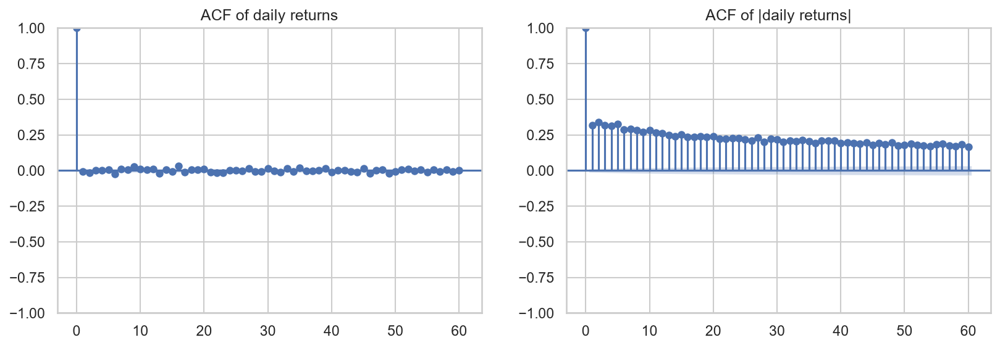
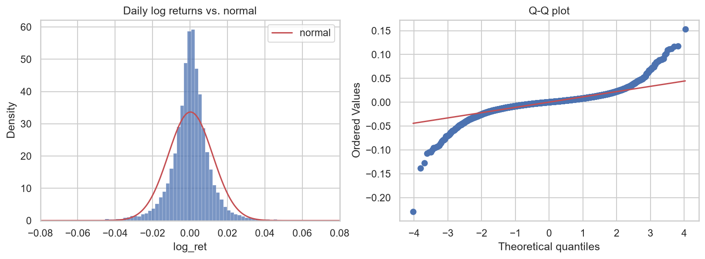
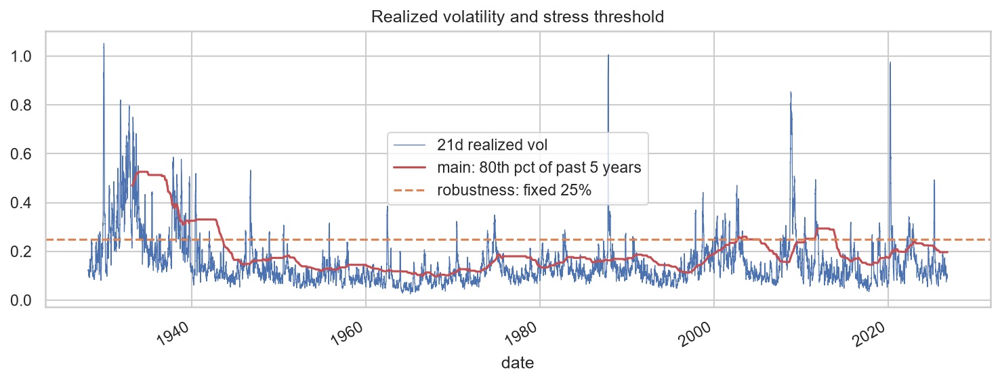
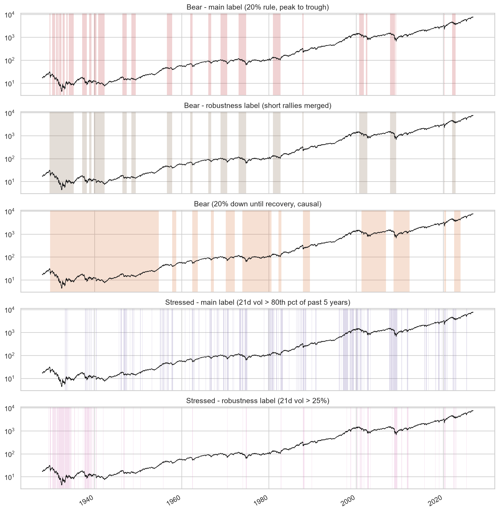
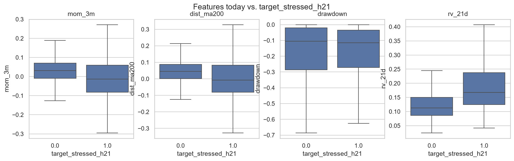
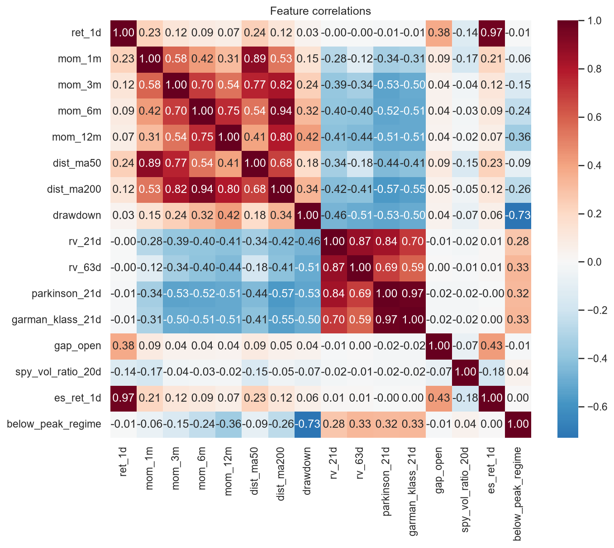

# 4. Exploratory Data Analysis

Notebook: [`notebooks/01_eda.ipynb`](../notebooks/01_eda.ipynb). Key figures are copied to [`docs/figures/`](figures/); all figures are written to `reports/figures/` when the notebook runs.

Data: cleaned `^GSPC` and the model table (1927-12-30 → 2026-10-23, 24,821 trading days), after the cleaning and label decisions in [03_data_preparation.md](03_data_preparation.md).

## Key findings

### 1. Daily direction is unpredictable, but volatility is not

- **Returns have no memory:** the autocorrelation of daily returns is about 0 at every lag up to 60 days. Yesterday's direction says nothing about today's. This is why "predict tomorrow's price" projects usually fail out of sample.
- **The size of moves has long memory:** the autocorrelation of |returns| is 0.3 at lag 1 and still about 0.2 after 60 days. Calm periods stay calm and volatile periods stay volatile.
- **Implication:** volatility-based regimes (stress) are the most predictable target. Volatility features (`rv_21d`, `rv_63d`, `parkinson_21d`) should carry most of the signal.

### 2. Returns have very fat tails

- Annualized return 6.2% and volatility 18.8% (price only, 1928–2026). Skew −0.46, **excess kurtosis 18.7**.
- The Q–Q plot bends sharply at both ends. Crash days such as −20.5% on 1987-10-19 are about 20 standard deviations from the mean.
- **Implication:** don't assume normal returns. Scale features robustly, and check model behavior during crashes.

### 3. Volatility differs a lot between eras, so the stress label must be relative

| Decade | Ann. return | Ann. volatility | `stressed` share |
|---|---|---|---|
| 1930s | −5.5% | 34.4% | 17% |
| 1950s | 12.8% | 11.5% | 16% |
| 1960s | 4.4% | 10.1% | 18% |
| 1980s | 11.8% | 17.4% | 30% |
| 2000s | −2.8% | 22.2% | 32% |
| 2010s | 10.7% | 14.8% | 16% |
| 2020s | 12.6% | 20.2% | 19% |

Volatility in the 1930s was three times that of the 1960s. A threshold based on all history labeled almost nothing stressed for 30 years, so the main label compares with the **previous 5 years**. Stressed shares now stay within 15–32% per decade.

### 4. The labels capture the known crises

- **Bear (main):** 27 episodes, 20.9% of days. Fully covers 1973–74, 2020 and 2022, and 92% of 2007–09. It splits 1929–32 and 2000–02 at 20% rallies; the merged robustness label joins them.
- **Stressed (main):** 266 episodes, 22.0% of days, median length 7 days. It catches every major crisis and also medium sell-offs (1962, 1966, 1970), while calm 2017 has 0 stressed days.

### 5. Bear and stress are related but different

| | Not stressed | Stressed |
|---|---|---|
| **Bull** | 66.2% | 14.4% |
| **Bear** | 11.9% | 7.6% |

- 39% of bear days are stressed, vs. 18% of bull days.
- Only 35% of stressed days are inside bear markets. Most stress happens in bull markets (corrections, short shocks).
- Annualized return: **bear −57%**, bull +23%; stressed +3.9%, calm +8.5%.
- When a bear market starts, stress usually follows within 0–6 weeks (2020: 5 days, 2007: 23 days, 2022: 31 days). But the bear start is dated at the peak, which is only known in hindsight.
- **Implication:** keep both targets. They answer different questions.

### 6. Regimes are very persistent, so accuracy is misleading

| Target | "No change" accuracy | Share of future regime days that are **new** (today = 0) |
|---|---|---|
| Bear, 5 days | 98.9% | 2.6% |
| Bear, 21 days | 95.5% | 10.9% |
| Stressed, 5 days | 93.2% | 15.5% |
| Stressed, 21 days | 81.8% | **41.4%** |

- Guessing "same as today" is right 99% of the time for bear at 5 days, so **accuracy can't separate good models from useless ones.**
- The value of a model is in predicting **new** regime days. That's rare for bear at short horizons but common for stress at 21 days (41%).
- **Implication:** evaluate on PR-AUC, on days when the regime is *not yet* active ("onset" PR-AUC), on calibration (Brier), and on early-warning lead time. The 21-day stress target has the most room to improve on persistence.

### 7. Features separate the future regimes, but with overlap

| Median value today | Calm in 21 days | Stressed in 21 days | Bull in 21 days | Bear in 21 days |
|---|---|---|---|---|
| 3-month momentum | +3.1% | −1.4% | +3.5% | −2.6% |
| Distance from 200-day MA | +4.6% | −0.8% | +5.1% | −3.4% |
| Drawdown from peak | −10.6% | −11.5% | −8.0% | −23.3% |
| 21-day realized vol | 11.2% | 16.8% | 11.7% | 16.3% |

- **Stress** is mostly signaled by current volatility. **Bear** is mostly signaled by drawdown and trend (below the 200-day MA).
- The distributions overlap a lot, so no single feature is enough and models must combine them.

### 8. Several features are near-duplicates

| Pair | Correlation | Keep |
|---|---|---|
| Parkinson vs. Garman-Klass volatility | 0.97 | Parkinson |
| ES daily return vs. index daily return | 0.97 | Index return (longer history) |
| 6-month momentum vs. distance from 200-day MA | 0.94 | Distance from 200-day MA |
| 1-month momentum vs. distance from 50-day MA | 0.89 | Both (below 0.9) |

- **Implication:** linear models and SVM get a reduced feature set without the duplicates. Gradient boosting would cope, but uses the same set so results are comparable.

## Checklist

### Structure and quality
- [x] Rows, date range and columns for each series
- [x] Missing values per column over time
- [x] Data quality report (see also [02_data_understanding.md](02_data_understanding.md))
- [x] Flagged large moves: genuine, except 4 suspected bad prints (fixed in cleaning)

### Price and returns
- [x] Log-price chart of `^GSPC` for the full history
- [x] Distribution of daily log returns vs. a normal distribution
- [x] Autocorrelation of returns vs. absolute returns
- [x] Return statistics by decade

### Volatility
- [x] 21-day realized volatility with the 5-year threshold and the fixed 25% level
- [x] Close-to-close vs. Parkinson vs. Garman-Klass volatility (correlations 0.70–0.97)

### Regimes
- [x] Price chart with bear periods shaded (all methods)
- [x] Price chart with stressed periods shaded (both labels)
- [x] 2000–02, 2007–09, 2020 and 2022 captured
- [x] Class balance
- [x] Regime durations and number of episodes
- [x] Bear/stressed overlap
- [x] Returns and volatility by regime

### Features vs. target
- [x] Correlation heatmap of features
- [x] Feature distributions split by future regime
- [x] Persistence: P(regime at t+h | regime at t)
