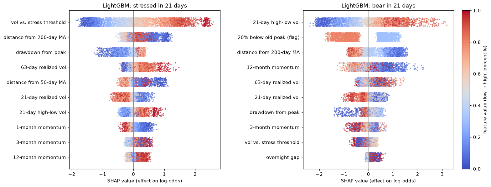
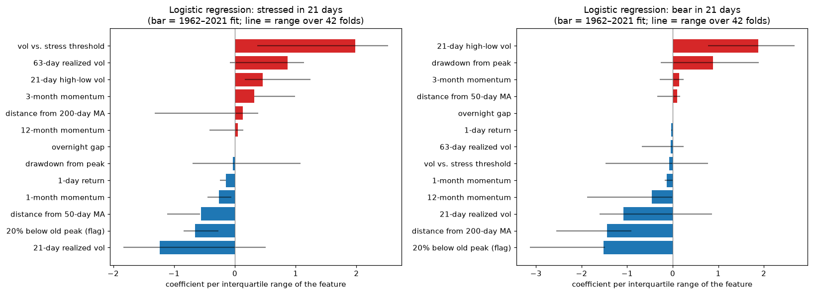

# 6. Modeling and Evaluation (first round)

Code: [`src/sp500/models.py`](../src/sp500/models.py), [`run_models.py`](../run_models.py). Full tables: [`reports/model_results_main.md`](../reports/model_results_main.md).

```bash
python process_data.py
python run_models.py            # ~2 minutes
```

## Setup (fixed before any results)

| Item | Choice | Why |
|---|---|---|
| Research focus | Regime prediction; **SVM is one of the compared models** | Links the project to the literature review (Sheta et al., Chen et al., Rosillo et al.) |
| Features | 13 "main" features available from 1962 (`config.FEATURES_MAIN`) | Real OHL starts in 1962; near-duplicates from EDA removed |
| Training data | 1962 → year before the test year (expanding) | The first fold already includes 4 bear markets (1962, 1966, 1968–70, 1973–74) |
| Test years | **1980–2021**, one year at a time (42 folds) | 2022+ is the untouched final holdout |
| Gap | 21 trading days between train and test | ≥ the longest horizon, so overlapping targets can't leak |
| Bear labels in training | **Recomputed in each fold using only prices known at the cut-off** | The bear label needs hindsight; this stops training from seeing how later bears were dated |
| Hyperparameters | Fixed defaults, no tuning | Tuning on the test years would overstate results |
| Class imbalance | No reweighting | Keeps probabilities calibrated (Brier); PR-AUC handles imbalance |

**Methods**

| Type | Method | Details |
|---|---|---|
| Baseline | No change (persistence) | Future regime = current *known* state (stress now; for bear, "20% below the old peak") |
| Baseline | Price < 200-day MA | Bear targets only |
| Baseline | 2-state HMM | Gaussian HMM on daily returns; causal forward filter, projected *h* days ahead |
| Model | Logistic regression | Robust scaling, L2 (C = 1) |
| Model | LightGBM | 200 trees, depth-limited (15 leaves, ≥ 200 rows per leaf) |
| Model | SVM (RBF) | Trained on weekly rows (as in Sheta et al.), Platt-scaled probabilities |

## Results (walk-forward, 1980–2021)

### Stress: models clearly beat the baselines

| `stressed` (main label) | PR-AUC, 5 days | PR-AUC, 21 days | Onset PR-AUC, 21 days | Brier, 21 days |
|---|---|---|---|---|
| Base rate (random guess) | 0.266 | 0.266 | 0.128 | – |
| Baseline: no change | 0.776 | 0.512 | 0.128 | 0.188 |
| Baseline: 2-state HMM | 0.749 | 0.531 | 0.191 | 0.161 |
| **Logistic regression** | **0.930** | **0.661** | 0.260 | **0.143** |
| **LightGBM** | 0.927 | 0.648 | **0.265** | 0.148 |
| SVM (RBF) | 0.847 | 0.555 | 0.211 | 0.157 |

- **Big improvement over "no change":** at 21 days, PR-AUC rises from 0.51 to 0.66. On days that are still calm, the models identify upcoming stress about **twice as well** as "no change" (onset PR-AUC 0.26 vs. 0.13).
- **The robustness label agrees:** on `stressed_fixed` (> 25% vol), logistic regression scores 0.56 vs. 0.32 for "no change" at 21 days. The conclusion doesn't depend on the stress definition.
- **Simple wins:** logistic regression is as good as LightGBM, and the SVM is clearly behind both. This is consistent with EDA finding 1: stress is driven by volatility persistence, which is close to linear.

### Bear markets: models recognize them, but can't predict their start

| `bear` (main label) | PR-AUC, 5 days | PR-AUC, 21 days | Onset PR-AUC, 21 days | Brier, 21 days |
|---|---|---|---|---|
| Base rate (random guess) | 0.114 | 0.116 | 0.018 | – |
| Baseline: no change | 0.131 | 0.122 | 0.017 | 0.335 |
| Baseline: price < 200-day MA | 0.299 | 0.261 | 0.018 | 0.204 |
| Baseline: 2-state HMM | 0.277 | 0.280 | **0.044** | 0.116 |
| Logistic regression | **0.361** | 0.293 | 0.032 | 0.100 |
| **LightGBM** | 0.358 | **0.340** | 0.014 | 0.103 |
| SVM (RBF) | 0.355 | 0.313 | 0.019 | **0.091** |

- **Overall PR-AUC is about 3× random** (0.34–0.36 vs. 0.11) and beats every baseline. That comes from recognizing a bear market **while it's underway** (deep drawdown, below trend, high volatility).
- **Onset PR-AUC is at the random level** (0.014–0.032 vs. a base rate of 0.018). No method can tell, from a normal-looking day, that a bear market will start within 21 days.
- This is expected. The bear label starts at the **market peak**, the day the market looks strongest. Only 7 bear markets start in the test years, so there's very little to learn from.
- **The robustness label agrees** (`bear_merged`: same pattern).


**Timeline (2000–2021):**
- **Stress (top):** the probability rises at almost every stress episode (2000–02, 2007–09, 2011, 2015, 2018, 2020) and stays low in calm years (2004–06, 2013–14, 2017).
- **Bear (bottom):** the model is high during 2008 but mostly low during the 2000–02 bear market. It gives false alarms in **2015–16 and late 2018**, which were sharp sell-offs of 14–20% that never became official bear markets.

### Early warning

Days of warning before a regime started (probability ≥ 50% on the days before the start):

| | Stress starts (130) with ≥ 5 days warning | Bear starts (7) with ≥ 5 days warning |
|---|---|---|
| Best model | 13% (LightGBM) | 0% |

Stress usually starts suddenly (one bad day pushes volatility above the threshold), so true early warning is rare. The models' value is mostly in **recognizing stress within the first days** and in **ranking risk** (higher probability before stress than before calm), not in long advance warning.

## Feature group tests (SPY volume, VIX)

Code: [`run_feature_groups.py`](../run_feature_groups.py). Full tables: [`reports/feature_groups.md`](../reports/feature_groups.md).

**Method.** Each group is added on top of the 13 main features and compared with the main features alone, on **exactly the same rows**: training from 1993 (when both groups exist), test years 2000–2021, logistic regression and LightGBM. The decision rule was fixed in `config.py` before running: keep a group only if mean PR-AUC over the 4 main targets improves by **≥ 0.01 for both models**, and onset PR-AUC drops by no more than 0.01.

**New data:** `^VIX` (CBOE Volatility Index: the market's expected volatility over the next 30 days, from option prices), 1990-01-02 → 2026-10-23, in `data/raw/vix.csv`. Features: `vix` (level), `vix_rv_spread` (VIX minus realized vol: the "fear premium"), `vix_chg_5d` (1-week change).

| Group | Δ PR-AUC (logistic / LightGBM) | Δ onset PR-AUC | Decision |
|---|---|---|---|
| SPY volume (`spy_vol_ratio_20d`) | +0.005 / +0.002 | +0.011 / +0.010 | ❌ **Drop** (below the 0.01 bar) |
| VIX (3 features) | **+0.020 / +0.018** | **+0.043 / +0.018** | ✅ **Passes the rule** |

**VIX: useful, but not worth its shorter history.**
- **Where it helps:** logistic regression gains mostly on stress in 21 days (0.569 → 0.626); LightGBM gains mostly on bear (0.233 → 0.266).
- **The gain is not robust.**
  - On the robustness labels it nearly disappears (mean +0.001 / +0.002).
  - Year by year, LightGBM improves in only 9 of 16 test years with both classes. Logistic regression improves in 14 of 16.
- **Using VIX means training from 1990, and that costs more than VIX adds.** On the same test years 2000–2021:

| Target (2000–2021) | Main model: 1962+, no VIX | "Modern" model: 1990+, with VIX |
|---|---|---|
| Stressed in 21 days (logistic regression) | **0.725** | 0.674 |
| Stressed in 21 days (LightGBM) | **0.721** | 0.688 |
| Bear in 5 days (logistic regression) | **0.375** | 0.153 |
| Bear in 21 days (LightGBM) | **0.247** | 0.207 |

  With training from 1990, the early folds contain only one short bear market (1990), so the bear models barely learn. Even for stress, 28 extra years of history beat VIX.

**Decision:** the **main 1962 model (13 features, no VIX) stays the primary model**. The VIX model is kept for reference ([`reports/model_results_modern.md`](../reports/model_results_modern.md), `python run_models.py --features modern`).

**Last check: VIX on the full history.** LightGBM can train with missing values, so it was trained from 1962 with the VIX features left empty before 1990, and compared with LightGBM on the main features on identical rows and test years 2000–2021. The same thresholds were used, applied to LightGBM only, since logistic regression can't take missing values. Full tables: [`reports/feature_groups_vix_hybrid.md`](../reports/feature_groups_vix_hybrid.md).

| LightGBM, 2000–2021 | Bear 5d | Bear 21d | Stressed 5d | Stressed 21d | Mean (main) |
|---|---|---|---|---|---|
| Main features | **0.312** | **0.247** | **0.955** | **0.721** | **0.559** |
| + VIX (missing before 1990) | 0.275 | 0.230 | 0.952 | 0.703 | 0.540 |

- **Result: −0.018 mean PR-AUC (−0.018 on the robustness labels too) → ❌ drop.**
- Onset PR-AUC is unchanged (+0.001). Only `stressed_fixed` at 21 days improves (0.602 → 0.629).
- Year by year it beats the main set in 12 of 16 years on stressed-21d, but it's worse when all years are pooled. Its probabilities seem less consistent across years: before 1990 the model learned from rows with VIX missing, after 1990 from rows with VIX present.

**Final decision on VIX: not used.** All three ways of adding it (common 1993+ sample, separate 1990+ model, full history with VIX missing) either fail the rule or lose to the main model on the same test years.

**Side finding (2000–2021 only):** for **bear**, the simple baselines are as good as or better than the models. At 21 days, the 2-state HMM scores 0.352 and the 200-day-MA rule 0.317, vs. 0.268 for logistic regression. The models' bear advantage in the full 1980–2021 test comes mostly from the 1980s–90s.

## Model interpretation

Code: [`interpret_models.py`](../interpret_models.py). Full tables: [`reports/interpretation.md`](../reports/interpretation.md).

Both models are refit on 1962–2021 for the 21-day targets. Bear labels are recomputed with prices up to 2021-12-31, so the holdout is not touched. Logistic regression coefficients are also refit in each of the 42 walk-forward folds, to check that their signs are stable.

### What drives the predictions (LightGBM SHAP, by feature group)

| Group | Stressed in 21 days | Bear in 21 days |
|---|---|---|
| Volatility (`rv_vs_5y_p80`, `rv_21d`, `rv_63d`, `parkinson_21d`) | **51%** | **41%** |
| Trend / momentum (moving-average distances, momentum) | 30% | 33% |
| Drawdown (`drawdown`, `below_peak_regime`) | 13% | 24% |
| Daily moves (`ret_1d`, `gap_open`) | 6% | 2% |



*How to read it:* each dot is one day. Dots to the right raise the predicted probability, dots to the left lower it. Red means the feature was high that day, blue means low.

**Stress in 21 days:**
- **The single strongest signal is how close volatility already is to the stress threshold** (`rv_vs_5y_p80`). It's the top feature in both models (31% of SHAP; logistic coefficient +1.98, same sign in 100% of folds). This is volatility clustering (EDA finding 1): volatility that's rising toward the threshold tends to cross it.
- **Longer-run volatility adds to it:** high 63-day and high-low (Parkinson) volatility raise the probability, in all or almost all folds.
- **Trend matters next:** price below its 50-day and 200-day averages raises stress risk (`dist_ma50` coefficient −0.56, same sign in 100% of folds).
- **Daily moves barely matter** (6%). One day's return says little about the next month.

**Bear in 21 days:**
- **High-low (intraday range) volatility is the top feature** (25% of SHAP; coefficient +1.87, 100% of folds). Wide daily ranges are typical of bear markets.
- **Trend is the second pillar:** below the 200-day average (coefficient −1.45, 100% of folds) and weak 12-month momentum (−0.46, 100% of folds).
- **The "20% below old peak" flag lowers the probability** (coefficient −1.52, 100% of folds). That seems backwards, but it's correct: the bear label ends at the trough, while the flag stays on during the whole recovery until the old high is regained. So "flag on" mostly means "already past the worst".



**Caveat: correlated features.** The volatility features are highly correlated, so each coefficient means the effect *with the others held fixed*. That's why `rv_21d` has a **negative** stress coefficient (−1.23) next to the strongly positive `rv_vs_5y_p80` (+1.98) and `rv_63d` (+0.87). The model uses it to offset the overlapping volatility features. It does **not** mean "higher volatility lowers stress risk". Together, the volatility group pushes strongly toward stress, and the group totals above are the safer reading. Signs that change across folds (same sign in < 80%: `drawdown`, `mom_12m`, `dist_ma200` for stress; `drawdown`, `mom_3m`, `dist_ma50`, `rv_63d`, `rv_vs_5y_p80` for bear) shouldn't be interpreted.

## Per-crisis results (out-of-sample, 21-day horizon)

### Stress episodes

When did each method's ≥ 50% signal start, relative to the first stressed day? **Negative = warned in advance**; +k = recognized k days after stress began.

| Crisis | Stress start | Max drawdown | HMM | Logistic | LightGBM | Mean P in the 21 days before (Logistic / LightGBM) |
|---|---|---|---|---|---|---|
| 1987 crash | 1987-09-01 | −34% | +0 | +24 | +30 | 0.08 / 0.20 |
| 1990 Gulf War | 1990-08-08 | −20% | missed | **−2** | **−2** | 0.28 / 0.14 |
| 1997 Asian crisis | 1997-10-21 | −11% | missed | +2 | +4 | 0.47 / 0.56 |
| 1998 LTCM / Russia | 1998-07-30 | −19% | missed | +1 | +3 | 0.22 / 0.39 |
| 2000 dot-com top | 2000-03-01 | −11% | missed | +4 | +4 | 0.38 / 0.38 |
| 2001 9/11 | 2001-09-17 | −37% | −3 | +3 | **−7** | 0.07 / 0.46 |
| 2002 accounting scandals | 2002-06-03 | −49% | +0 | +26 | +0 | 0.17 / 0.37 |
| 2007 subprime start | 2007-07-27 | −9% | −1 | +2 | +2 | 0.17 / 0.13 |
| 2008 Lehman | 2008-09-02 | −52% | −2 | +2 | +2 | 0.43 / 0.35 |
| 2010 flash crash / euro | 2010-05-10 | −35% | −4 | +8 | +8 | 0.06 / 0.04 |
| 2011 US downgrade | 2011-08-08 | −30% | −2 | +0 | **−2** | 0.07 / 0.12 |
| 2015 China devaluation | 2015-08-21 | −12% | +0 | +0 | +0 | 0.12 / 0.05 |
| 2018 Volmageddon | 2018-02-05 | −10% | +0 | +0 | +3 | 0.03 / 0.06 |
| 2018 Q4 sell-off | 2018-10-12 | −20% | −2 | +4 | +4 | 0.07 / 0.04 |
| 2020 COVID | 2020-02-24 | −34% | +0 | +1 | +1 | 0.08 / 0.17 |

*(Max drawdown is the market's distance from its all-time high at the worst point of the window, so it includes earlier losses.)*

- **The models signal stress no later than 4 days after it begins in most crises** (logistic regression 12 of 15, LightGBM 13 of 15). Real advance warning (negative) happens in only 3 crises, for at least one model (1990, 9/11, 2011).
- **The slow cases are slow-building crises:**
  - 1987: stress began in September, five weeks before the crash.
  - 2002: logistic regression +26 days.
  - 2010: +8 days.
- **Sudden shocks are recognized within 0–4 days** but not anticipated: COVID, 2018 Q4 and Volmageddon all had probabilities of 0.2 or less beforehand.
- **Probability is already elevated (0.2–0.6) before crises that follow earlier turbulence** (1997, 1998, 2000, 2008): the market was already nervous.
- **The HMM baseline sometimes signals earlier (−1 to −4 days), but that's mostly noise.** Its signal switches on and off ~14 times a year, so it's "on" often; it also misses 4 crises completely.

### Bear markets

When did each method first say ≥ 50% "bear within 21 days", counted from the market **peak**, and how far had the market already fallen?

| Bear (peak → trough) | Fall | MA200 rule | Logistic | LightGBM |
|---|---|---|---|---|
| 1980-11 → 1982-08 | −27% | +108 days (−7%) | +136 days (−5%) | +37 days (−7%) |
| 1987-08 → 1987-12 | −34% | +36 days (−11%) | +43 days (−32%) | +37 days (−16%) |
| 2000-09 → 2001-09 | −36% | +10 days (−5%) | +27 days (−10%) | +27 days (−10%) |
| 2002-03 → 2002-07 | −32% | +4 days (−3%) | +78 days (−21%) | +75 days (−15%) |
| 2007-10 → 2008-11 | −52% | +21 days (−6%) | +71 days (−16%) | +72 days (−14%) |
| 2009-01 → 2009-03 | −28% | already on | +0 days | never |
| 2020-02 → 2020-03 | −34% | +6 days (−12%) | never | +18 days (−30%) |

- **No method calls a bear market at the top.** The models' signal usually comes **1–3 months after the peak** (up to ~6 months in 1980), when the market is already **5–32% down**, most often 10–20%.
- **The 200-day-MA rule signals sooner** (often after a 3–12% fall), **but it switches on and off ~6 times a year**, so most of its signals are false alarms. The models are slower but switch ~2.5–3 times a year.
- **Both models missed or were very late on COVID** (logistic never; LightGBM +18 days at −30%). The crash was too fast for trend-based features: the whole bear market lasted 23 trading days.

## Conclusions

1. **Stress is predictable; bear-market starts are not.** For the report: the useful product is a calibrated "stress in the next 1–4 weeks" probability.
2. **Logistic regression is the recommended main model:** best or tied-best on most metrics, simple, and interpretable. LightGBM is a close second, and the SVM is third.
3. **Long history beats extra data sources.** SPY volume doesn't help. VIX helps a little on a common 1993+ sample, but it loses to the main model whether it's used in a 1990+ model or on the full history with missing values. The primary model keeps the 13 main features.
4. **For bear markets, simple rules are hard to beat** in recent decades (2000–2021).
5. **The models are mainly fast regime recognizers, not forecasters of shocks.** Stress is driven by volatility clustering (about half of the explanatory weight). The models recognize stress within days in most crises, but rarely before it starts. Bear markets are flagged 1–3 months after the peak.
3. **The SVM result is relevant to the literature:** in this regime task, an RBF SVM doesn't beat simpler models, unlike the price-level forecasts in Sheta et al. Note that we use a much longer test period (42 years vs. 43 weekly points).

## Next steps

The 2022+ holdout has been run once with this setup: see [07_final_evaluation.md](07_final_evaluation.md).
