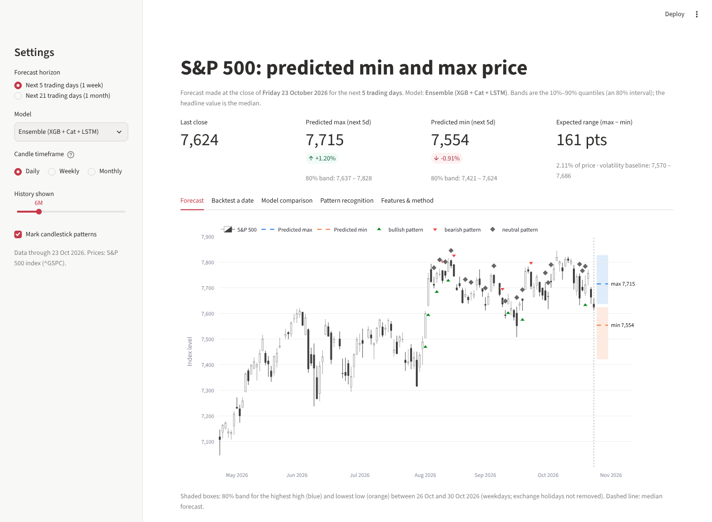

# 8. Extension: predicting the min and max price (dashboard)

The regime models (chapters 1–7) answer "will the market be bear / stressed?". This extension
answers the professor's follow-up question: **how high and how low will the S&P 500 go over the
next week and the next month?** Results are shown in an interactive dashboard.

| Piece | File |
|---|---|
| Candlestick pattern recognition | `src/sp500/patterns.py` |
| Candle resampling (daily ↔ weekly / monthly) | `src/sp500/candles.py` |
| Features + min / max targets | `src/sp500/range_data.py` |
| XGBoost, CatBoost, LSTM, baselines | `src/sp500/range_models.py` |
| Training, validation, forecast | `run_range_models.py` |
| Results | [`reports/range_results.md`](../reports/range_results.md) |
| Dashboard | `dashboard/app.py` (`streamlit run dashboard/app.py`) |



## 8.1 Targets

For each day *t* and horizon *h* ∈ {5, 21} trading days:

- `up_h   = log( max(high[t+1 … t+h]) / close[t] )` → **max price** = close × e^up
- `down_h = log( min(low [t+1 … t+h]) / close[t] )` → **min price** = close × e^down

The models predict the **10%, 50% and 90% quantiles** of each target, so the dashboard shows a
median forecast plus an 80% band. Targets are divided by a causal volatility scale
σ = Parkinson 21-day vol × √(h/252) before training, so calm and crisis years share one scale.

## 8.2 Features (72, all known at the close of day *t*)

1. **The 13 regime features** of the main model (momentum, trend, drawdown, volatility, gap).
2. **Range features:** ATR(14), 1/5/21-day high–low range, distance to the 5- and 21-day
   high and low, candle body and shadows, short-to-long volatility ratio.
3. **Pattern recognition** (13 candlestick patterns: doji, hammer, shooting star, bullish / bearish
   engulfing, morning / evening star, three white soldiers, three black crows, inside / outside bar,
   bullish / bearish marubozu). Each is a flag on the day, plus "seen in the last 3 candles" and
   a net bullish-minus-bearish score.
4. **Candle resampling (multi-timeframe).** Daily candles are aggregated into weekly and monthly
   candles (open = first, high = max, low = min, close = last). These are mapped back
   (*upsampled*) to every day using only **closed** candles: last week's / month's range, body,
   8-candle average range, pattern score and the distance from today's close to last
   week's / month's high and low. The still-forming week-to-date and month-to-date candle
   (range, return, position of the close inside it) is added too.

**No look-ahead:** rebuilding the features on data cut at 2015-06-17 gives identical values
for every feature (checked when the table is built).

## 8.3 Models

| Model | Setup |
|---|---|
| Baseline: historical quantiles | Quantiles of the raw target in the training data (ignores today) |
| Baseline: volatility band | Quantiles of target / σ in training × today's σ (strong standard benchmark) |
| XGBoost | `reg:quantileerror`, 3 quantiles in one model, 400 trees, depth 4 |
| CatBoost | `MultiQuantile`, 400 trees, depth 4, l2 = 10 |
| LSTM | 30-day window of standardized features → 48 hidden units → 2 targets × 3 quantiles, pinball loss, early stopping on the last 10% of training |
| Ensemble | Average of XGBoost, CatBoost and LSTM quantiles |

CatBoost was first run with depth 5 / lr 0.05. It overfit, so depth 4 / lr 0.03 / l2 10 was
chosen by comparing three settings **on the 2000–2021 walk-forward only**. *Caveat:* the first
quick run had already printed holdout numbers, so the CatBoost holdout result is not 100% blind.

## 8.4 Validation

- **Walk-forward 2000–2021:** retrain every 2 years on all earlier data, with a 21-day gap
  plus *h* days so no training target overlaps the test block.
- **Holdout 2022-01-01 → 2026-10-23:** one model per method trained on data before 2022.
  This is a new target, so the holdout is fresh for this task (the regime holdout rule is untouched).
- **Final models** are trained on all data and make the forecast shown in the dashboard.

Metrics: MAE of the median (in % of price), pinball (quantile) loss, coverage of the 80% band,
band width, and skill = 1 − MAE / MAE of the volatility band.

## 8.5 Results

Pinball loss ×100 (lower is better). Full tables: [`reports/range_results.md`](../reports/range_results.md).

| Target | Vol. band | XGBoost | CatBoost | LSTM | Ensemble |
|---|---|---|---|---|---|
| **Walk-forward 2000–2021** | | | | | |
| Max, next 5 days | 0.297 | 0.290 | 0.289 | 0.291 | **0.288** |
| Min, next 5 days | 0.410 | 0.405 | 0.407 | 0.405 | **0.404** |
| Max, next 21 days | 0.544 | 0.567 | 0.565 | **0.538** | 0.542 |
| Min, next 21 days | **0.905** | 0.921 | 0.940 | 0.906 | 0.911 |
| **Holdout 2022+** | | | | | |
| Max, next 5 days | 0.313 | **0.297** | **0.297** | 0.303 | 0.298 |
| Min, next 5 days | 0.400 | 0.394 | **0.393** | 0.395 | **0.393** |
| Max, next 21 days | 0.575 | 0.554 | **0.549** | 0.570 | 0.555 |
| Min, next 21 days | **0.799** | 0.811 | 0.833 | 0.819 | 0.816 |

**What this means**

- **Next-week range: the ML models win, by a small margin.** All three beat both baselines in
  walk-forward and holdout, for the max and the min. The median max-price error is ~0.93% of price
  (≈ 70 points at 7,600).
- **Next-month max:** boosting wins clearly on the holdout (+5% skill), the LSTM in walk-forward.
- **Next-month min: nothing beats the volatility band.** Big drops come from shocks (2020, the
  April 2025 tariff crash) that no feature sees coming; this matches the regime finding that
  bear-market *starts* are not predictable.
- **Most of the skill is volatility.** Top features are Parkinson / realized vol, ATR and the
  distance to recent highs / lows, then the weekly / monthly candle features. Candlestick
  patterns barely change the *direction* of the next week (all patterns: 53–61% up days vs 57%
  overall) but strong bearish candles do come before wider ranges.
- **Bands are a bit too narrow for the min:** 80% bands cover the min 69–73% of the time (fat left tail).
  Conformal calibration of the band would be a natural next step.

## 8.6 Running it

```bash
pip install -r requirements.txt
python process_data.py           # if data/processed/ is empty
python run_range_models.py       # ~6 min on 2 cores (--fast: 4-year blocks, --no-lstm)
streamlit run dashboard/app.py
```

Dashboard tabs: **Forecast** (candles + predicted max / min boxes, any model, daily / weekly /
monthly candles, pattern markers), **Backtest a date** (pick any day since 2000 and compare the
out-of-sample prediction with what happened), **Model comparison**, **Pattern recognition**,
**Features & method**.
