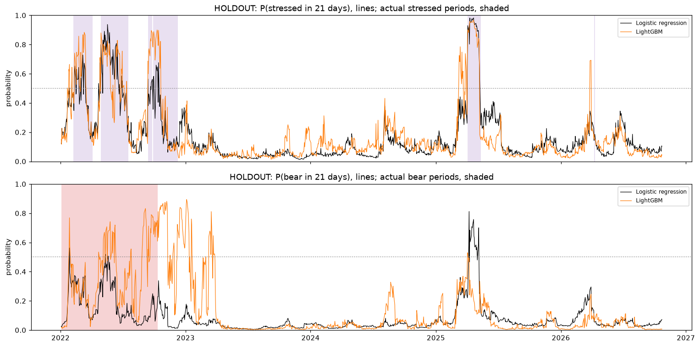

# Final holdout results (one-time test)

Generated 2026-10-27 15:35 by `run_holdout.py`. Test period **2022-01-01 → 2026-10-16** (last day whose target is already known). Models refit each January on all data from 1962, 21-day gap. Setup identical to validation; nothing was tuned on this period.

## `bear` in 5 days

Holdout base rate 15.9% (1,202 days).

| Method | PR-AUC (holdout) | PR-AUC (validation 1980–2021) | Onset PR-AUC (holdout) | Brier (holdout) |
|---|---|---|---|---|
| Baseline: no change | 0.181 | 0.131 | – | 0.340 |
| Baseline: price < 200-day MA | 0.465 | 0.299 | – | 0.142 |
| Baseline: 2-state HMM | 0.464 | 0.277 | – | 0.116 |
| Logistic regression | 0.481 | 0.361 | – | 0.117 |
| LightGBM | 0.448 | 0.358 | – | 0.110 |
| SVM (RBF) | **0.612** | 0.355 | – | 0.099 |

## `bear` in 21 days

Holdout base rate 14.8% (1,186 days).

| Method | PR-AUC (holdout) | PR-AUC (validation 1980–2021) | Onset PR-AUC (holdout) | Brier (holdout) |
|---|---|---|---|---|
| Baseline: no change | 0.156 | 0.122 | – | 0.358 |
| Baseline: price < 200-day MA | 0.413 | 0.261 | – | 0.158 |
| Baseline: 2-state HMM | 0.359 | 0.280 | – | 0.109 |
| Logistic regression | 0.433 | 0.293 | – | 0.112 |
| LightGBM | 0.345 | 0.340 | – | 0.119 |
| SVM (RBF) | **0.534** | 0.313 | – | 0.097 |

## `stressed` in 5 days

Holdout base rate 15.6% (1,202 days).

| Method | PR-AUC (holdout) | PR-AUC (validation 1980–2021) | Onset PR-AUC (holdout) | Brier (holdout) |
|---|---|---|---|---|
| Baseline: no change | 0.780 | 0.776 | 0.024 | 0.040 |
| Baseline: 2-state HMM | 0.687 | 0.749 | 0.165 | 0.091 |
| Logistic regression | 0.938 | 0.930 | 0.611 | 0.027 |
| LightGBM | 0.947 | 0.927 | 0.434 | 0.027 |
| SVM (RBF) | **0.954** | 0.847 | 0.518 | 0.038 |

## `stressed` in 21 days

Holdout base rate 15.8% (1,186 days).

| Method | PR-AUC (holdout) | PR-AUC (validation 1980–2021) | Onset PR-AUC (holdout) | Brier (holdout) |
|---|---|---|---|---|
| Baseline: no change | 0.384 | 0.512 | 0.082 | 0.138 |
| Baseline: 2-state HMM | 0.485 | 0.531 | 0.300 | 0.104 |
| Logistic regression | 0.549 | 0.661 | 0.516 | 0.094 |
| LightGBM | 0.590 | 0.648 | 0.622 | 0.084 |
| SVM (RBF) | **0.602** | 0.555 | 0.486 | 0.095 |

## `bear_merged` in 5 days

Holdout base rate 15.9% (1,202 days).

| Method | PR-AUC (holdout) | PR-AUC (validation 1980–2021) | Onset PR-AUC (holdout) | Brier (holdout) |
|---|---|---|---|---|
| Baseline: no change | 0.181 | 0.164 | – | 0.340 |
| Baseline: price < 200-day MA | 0.465 | 0.350 | – | 0.142 |
| Baseline: 2-state HMM | 0.464 | 0.313 | – | 0.116 |
| Logistic regression | 0.484 | 0.395 | – | 0.110 |
| LightGBM | 0.423 | 0.363 | – | 0.116 |
| SVM (RBF) | **0.560** | 0.362 | – | 0.097 |

## `bear_merged` in 21 days

Holdout base rate 14.8% (1,186 days).

| Method | PR-AUC (holdout) | PR-AUC (validation 1980–2021) | Onset PR-AUC (holdout) | Brier (holdout) |
|---|---|---|---|---|
| Baseline: no change | 0.156 | 0.152 | – | 0.358 |
| Baseline: price < 200-day MA | 0.413 | 0.312 | – | 0.158 |
| Baseline: 2-state HMM | 0.359 | 0.309 | – | 0.109 |
| Logistic regression | 0.441 | 0.338 | – | 0.107 |
| LightGBM | 0.346 | 0.335 | – | 0.124 |
| SVM (RBF) | **0.479** | 0.320 | – | 0.096 |

## `stressed_fixed` in 5 days

Holdout base rate 10.5% (1,202 days).

| Method | PR-AUC (holdout) | PR-AUC (validation 1980–2021) | Onset PR-AUC (holdout) | Brier (holdout) |
|---|---|---|---|---|
| Baseline: no change | 0.700 | 0.724 | 0.020 | 0.037 |
| Baseline: 2-state HMM | 0.552 | 0.426 | 0.146 | 0.110 |
| Logistic regression | 0.855 | 0.864 | 0.360 | 0.029 |
| LightGBM | **0.903** | 0.897 | 0.459 | 0.030 |
| SVM (RBF) | 0.740 | 0.812 | 0.091 | 0.050 |

## `stressed_fixed` in 21 days

Holdout base rate 10.6% (1,186 days).

| Method | PR-AUC (holdout) | PR-AUC (validation 1980–2021) | Onset PR-AUC (holdout) | Brier (holdout) |
|---|---|---|---|---|
| Baseline: no change | 0.244 | 0.315 | 0.068 | 0.121 |
| Baseline: 2-state HMM | 0.375 | 0.264 | 0.293 | 0.091 |
| Logistic regression | **0.437** | 0.563 | 0.566 | 0.078 |
| LightGBM | 0.359 | 0.487 | 0.342 | 0.085 |
| SVM (RBF) | 0.192 | 0.415 | 0.146 | 0.094 |

## Is the improvement over the baselines real? (block bootstrap)

95% confidence interval for PR-AUC(model) − PR-AUC(best baseline), resampling 63-day blocks (1,000 repetitions). If the interval stays above 0, the model is better than the baseline in the holdout.

| Target | Model | Best baseline | Difference | 95% CI |
|---|---|---|---|---|
| `stressed` 5d | Logistic regression | Baseline: no change | +0.158 | +0.097 to +0.281 |
| `stressed` 5d | LightGBM | Baseline: no change | +0.167 | +0.107 to +0.283 |
| `stressed` 21d | Logistic regression | Baseline: 2-state HMM | +0.064 | -0.136 to +0.350 |
| `stressed` 21d | LightGBM | Baseline: 2-state HMM | +0.105 | -0.056 to +0.343 |
| `bear` 5d | Logistic regression | Baseline: price < 200-day MA | +0.016 | -0.222 to +0.322 |
| `bear` 5d | LightGBM | Baseline: price < 200-day MA | -0.018 | -0.130 to +0.172 |
| `bear` 21d | Logistic regression | Baseline: price < 200-day MA | +0.020 | -0.261 to +0.378 |
| `bear` 21d | LightGBM | Baseline: price < 200-day MA | -0.068 | -0.188 to +0.172 |

## Stress episodes in the holdout (lasting ≥ 10 trading days)

Signal start relative to the first stressed day (21-day predictions): negative = warned in advance.

| Stress start | Days | HMM | Logistic | LightGBM |
|---|---|---|---|---|
| 2022-02-08 | 39 | +12 | +2 | +2 |
| 2022-04-28 | 55 | +0 | +1 | +1 |
| 2022-09-13 | 10 | +0 | +0 | +0 |
| 2022-09-28 | 52 | +1 | +1 | -11 |
| 2025-04-03 | 27 | +0 | +0 | +0 |

## Bear markets in the holdout

Bear market 2022-01-03 → 2022-10-12 (-25%). First ≥ 50% "bear within 21 days" signal:

| Method | Signal date | Days after peak | Market fall at signal |
|---|---|---|---|
| Baseline: price < 200-day MA | 2022-01-21 | 13 | -8% |
| Baseline: 2-state HMM | 2022-02-03 | 22 | -7% |
| Logistic regression | 2022-01-27 | 17 | -10% |
| LightGBM | 2022-01-25 | 15 | -9% |

