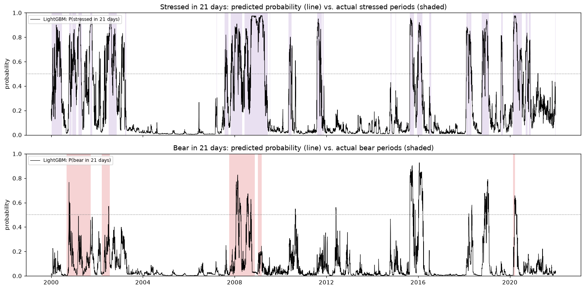

# Model results (main features)

Generated 2026-10-25 15:47 by `run_models.py`. Walk-forward out-of-sample predictions for **1980–2021** (one test year at a time; models retrained each year on all earlier data from 1962, with a 21-day gap). The 2022+ holdout is not used.

Features (13): `ret_1d`, `mom_1m`, `mom_3m`, `mom_12m`, `dist_ma50`, `dist_ma200`, `drawdown`, `below_peak_regime`, `rv_21d`, `rv_63d`, `parkinson_21d`, `rv_vs_5y_p80`, `gap_open`

**How to read the metrics**

- **PR-AUC:** how well the method ranks future regime days above normal days (1 = perfect; a random guess scores the base rate).
- **Onset PR-AUC:** the same, but only on days when the regime is **not active yet**: can it predict a regime *starting*? This is where a model must beat "no change".
- **Brier:** mean squared error of the probability (lower is better; 0 = perfect).
- **Flips/yr:** how often the 50% signal switches on/off per year (compare with the true number).
- Bold = best in the column.

## Main targets

### `bear` in 5 days

Base rate 11.4% of days; on not-yet-bear days, 0.4% turn bear within 5 days. True regime switches: 0.4 per year.

| Method | PR-AUC | Onset PR-AUC | Brier | Flips/yr |
|---|---|---|---|---|
| Baseline: no change | 0.131 | 0.004 | 0.321 | 0.3 |
| Baseline: price < 200-day MA | 0.299 | 0.004 | 0.187 | 6.4 |
| Baseline: 2-state HMM | 0.277 | **0.006** | 0.167 | 15.5 |
| Logistic regression | **0.361** | 0.005 | 0.094 | 3.0 |
| LightGBM | 0.358 | 0.003 | 0.101 | 4.0 |
| SVM (RBF) | 0.355 | 0.005 | **0.087** | 3.4 |

### `bear` in 21 days

Base rate 11.6% of days; on not-yet-bear days, 1.8% turn bear within 21 days. True regime switches: 0.4 per year.

| Method | PR-AUC | Onset PR-AUC | Brier | Flips/yr |
|---|---|---|---|---|
| Baseline: no change | 0.122 | 0.017 | 0.335 | 0.3 |
| Baseline: price < 200-day MA | 0.261 | 0.018 | 0.204 | 6.4 |
| Baseline: 2-state HMM | 0.280 | **0.044** | 0.116 | 13.6 |
| Logistic regression | 0.293 | 0.032 | 0.100 | 2.5 |
| LightGBM | **0.340** | 0.014 | 0.103 | 3.1 |
| SVM (RBF) | 0.313 | 0.019 | **0.091** | 1.7 |

### `stressed` in 5 days

Base rate 26.6% of days; on not-yet-stressed days, 5.1% turn stressed within 5 days. True regime switches: 6.2 per year.

| Method | PR-AUC | Onset PR-AUC | Brier | Flips/yr |
|---|---|---|---|---|
| Baseline: no change | 0.776 | 0.051 | 0.075 | 6.2 |
| Baseline: price < 200-day MA | – | – | – | – |
| Baseline: 2-state HMM | 0.749 | 0.149 | 0.111 | 15.5 |
| Logistic regression | **0.930** | **0.282** | **0.057** | 6.2 |
| LightGBM | 0.927 | 0.278 | 0.059 | 6.9 |
| SVM (RBF) | 0.847 | 0.220 | 0.083 | 8.2 |

### `stressed` in 21 days

Base rate 26.6% of days; on not-yet-stressed days, 12.8% turn stressed within 21 days. True regime switches: 6.2 per year.

| Method | PR-AUC | Onset PR-AUC | Brier | Flips/yr |
|---|---|---|---|---|
| Baseline: no change | 0.512 | 0.128 | 0.188 | 6.2 |
| Baseline: price < 200-day MA | – | – | – | – |
| Baseline: 2-state HMM | 0.531 | 0.191 | 0.161 | 13.6 |
| Logistic regression | **0.661** | 0.260 | **0.143** | 10.4 |
| LightGBM | 0.648 | **0.265** | 0.148 | 10.3 |
| SVM (RBF) | 0.555 | 0.211 | 0.157 | 12.0 |

## Robustness targets

### `bear_merged` in 5 days

Base rate 12.9% of days; on not-yet-bear_merged days, 0.3% turn bear_merged within 5 days. True regime switches: 0.3 per year.

| Method | PR-AUC | Onset PR-AUC | Brier | Flips/yr |
|---|---|---|---|---|
| Baseline: no change | 0.164 | 0.003 | 0.307 | 0.3 |
| Baseline: price < 200-day MA | 0.350 | 0.003 | 0.174 | 6.4 |
| Baseline: 2-state HMM | 0.313 | **0.004** | 0.164 | 15.5 |
| Logistic regression | **0.395** | 0.002 | 0.103 | 3.4 |
| LightGBM | 0.363 | 0.002 | 0.112 | 3.9 |
| SVM (RBF) | 0.362 | 0.003 | **0.097** | 3.4 |

### `bear_merged` in 21 days

Base rate 13.0% of days; on not-yet-bear_merged days, 1.4% turn bear_merged within 21 days. True regime switches: 0.3 per year.

| Method | PR-AUC | Onset PR-AUC | Brier | Flips/yr |
|---|---|---|---|---|
| Baseline: no change | 0.152 | 0.014 | 0.321 | 0.3 |
| Baseline: price < 200-day MA | 0.312 | 0.014 | 0.190 | 6.4 |
| Baseline: 2-state HMM | 0.309 | **0.026** | 0.118 | 13.6 |
| Logistic regression | **0.338** | 0.010 | 0.109 | 2.8 |
| LightGBM | 0.335 | 0.009 | 0.116 | 3.2 |
| SVM (RBF) | 0.320 | 0.014 | **0.102** | 1.8 |

### `stressed_fixed` in 5 days

Base rate 8.8% of days; on not-yet-stressed_fixed days, 1.5% turn stressed_fixed within 5 days. True regime switches: 2.1 per year.

| Method | PR-AUC | Onset PR-AUC | Brier | Flips/yr |
|---|---|---|---|---|
| Baseline: no change | 0.724 | 0.015 | 0.028 | 2.1 |
| Baseline: price < 200-day MA | – | – | – | – |
| Baseline: 2-state HMM | 0.426 | 0.102 | 0.132 | 15.5 |
| Logistic regression | 0.864 | 0.170 | 0.026 | 1.8 |
| LightGBM | **0.897** | **0.240** | **0.024** | 2.0 |
| SVM (RBF) | 0.812 | 0.143 | 0.034 | 2.2 |

### `stressed_fixed` in 21 days

Base rate 8.8% of days; on not-yet-stressed_fixed days, 4.6% turn stressed_fixed within 21 days. True regime switches: 2.1 per year.

| Method | PR-AUC | Onset PR-AUC | Brier | Flips/yr |
|---|---|---|---|---|
| Baseline: no change | 0.315 | 0.046 | 0.084 | 2.1 |
| Baseline: price < 200-day MA | – | – | – | – |
| Baseline: 2-state HMM | 0.264 | 0.118 | 0.101 | 13.6 |
| Logistic regression | **0.563** | **0.166** | **0.054** | 2.0 |
| LightGBM | 0.487 | 0.129 | 0.062 | 2.7 |
| SVM (RBF) | 0.415 | 0.102 | 0.067 | 1.0 |

## Early warning (21-day horizon)

For each regime start in the test years: consecutive trading days **before** the start on which the method's probability was already ≥ 50% (0 = no warning). Median over all starts, and the share of starts with at least 5 days of warning.

| Method | Stress starts: median days | ≥ 5 days warned | Bear starts: median days | ≥ 5 days warned |
|---|---|---|---|---|
| Baseline: no change | 0 | 0% | 0 | 29% |
| Baseline: price < 200-day MA | – | – | 0 | 14% |
| Baseline: 2-state HMM | 0 | 8% | 0 | 0% |
| Logistic regression | 0 | 5% | 0 | 0% |
| LightGBM | 0 | 13% | 0 | 0% |
| SVM (RBF) | 0 | 6% | 0 | 0% |

(130 stress starts and 7 bear starts in the test years. A bear start is dated at the market peak, which is only known in hindsight, so "warning" before it means the signal was already on at the top, e.g. because the market was still below an older high.)

## Timeline

Best model by mean PR-AUC on the main targets: **LightGBM**.

